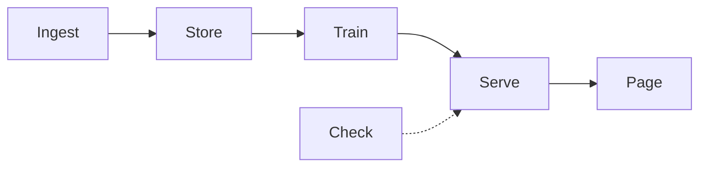

# Architecture: Street Count

An example team repo for the Finale lab's checks. The system is made up; its shape is the point.

Who it is for: a city mobility planner. What they need: the expected traffic count at a street
counter for a given day and hour, with a warning when the forecast should not be trusted.

The truth flows one way, from the counters on the left to the planner on the right.
No box writes back upstream. A planner's correction goes to the Store box, as a flagged row.

## Box: Ingest
Choice: a scheduled job every 15 minutes that pulls the city's public counter feed
Instead of: a stream that listens all the time
Because: the feed only updates every 15 minutes, so a stream would cost more and learn nothing new
Fails when: the feed is down; the job logs the gap and the Page shows the last good time

## Box: Store
Choice: one SQLite file in the repo
Instead of: a hosted Postgres database
Because: one writer, under a million rows, and the planner never edits it directly
Fails when: two jobs write at once; the schedule keeps them apart

## Box: Train
Choice: a weekly retrain of a day-and-hour model, with its error saved beside it
Instead of: retraining on every new row
Because: the pattern changes by season, not by hour, and a weekly error number is easy to compare
Fails when: a holiday week skews the model; the saved error rises and the Check flags it

## Box: Serve
Choice: a small REST API that scales to zero
Instead of: an always-on server
Because: the planner asks a few times a day, so paying for idle hours buys nothing
Fails when: the first request after a sleep is slow; the Page says "waking up" instead of failing

## Box: Page
Choice: a single page with one question box and one chart
Instead of: a dashboard with every counter on it
Because: the planner asks about one street at a time
Fails when: the model's error is above the limit; the page shows the warning before the number

## Box: Check
Choice: a smoke test and an error limit, run after every deploy
Instead of: a person looking at the chart
Because: a person stops looking after the first week
Fails when: the check itself is wrong; its own test cases live in runs/
