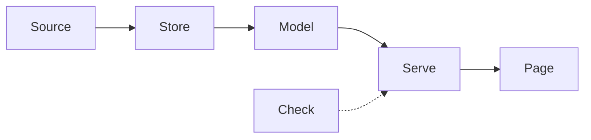

# Architecture: <your system's name>

Who it is for: <the stakeholder, by role>. What they need: <one sentence>.

The truth flows one way, from the source on the left to the person on the right.
No box writes back to a box upstream of it. Where a person corrects something, say which box owns the correction.

One section per box. The name after "Box:" must match the label in the diagram.

## Box: Source
Choice: <what you used>
Instead of: <the alternative you rejected>
Because: <the reason, in one sentence>
Fails when: <the way this box breaks, and what the person sees>

## Box: Store
Choice:
Instead of:
Because:
Fails when:
